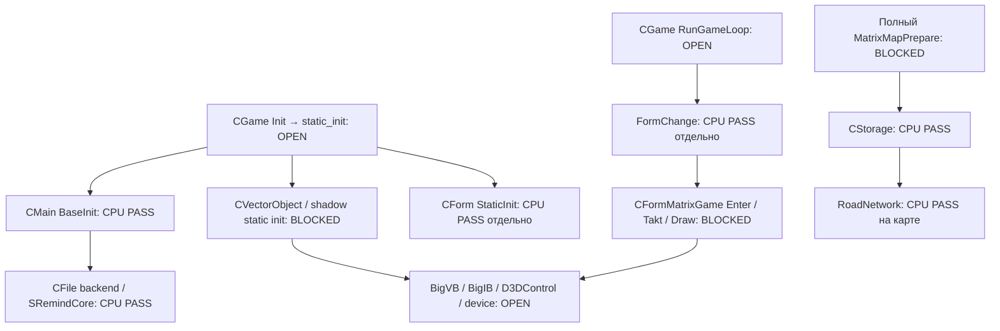

# MatrixGame E2E-5.15: состояние нативного порта

Дополнение 20.10: [BigVB/BigIB, адресные проверки и локальный коммит](matrixgame-e2e515-buffers.md).
Подготовлен отдельный аппаратный VO/deko3d smoke, GPU execution PENDING.
Новый большой этап переноса отложен до аппаратного прогона основной игры:
[комплекты и порядок проверки](e2e5/e2e515-hardware-first-run.md).

Дата: 20.10.2026. Исходный HEAD этого пакета:
`58bd45765b07180bf0ad94432f4c1129dfe595d0`.
Upstream MatrixGame: `218115a72fa9c5d43269f4ca84a8596a0bcb82f1`, подмодуль чистый.

Полный движок, native CGame Init/Run, настоящий планетарный бой и интеграция в
основной NRO пока отсутствуют. Подтверждённые новые части — полный release CPU-модуль
MatrixRoadNetwork и оригинальный lifecycle CMain/Form, связанные с native-core.
Это не выполнение боя и не аппаратная проверка Switch.

## Новый модуль и граница переносимости

`tools/matrixgame_navigation_overrides.py` проверяет SHA исходных cpp/hpp и меняет
только платформенные конструкции в disposable effective source: DWORD/BYTE на
фиксированные типы, CopyMemory/MoveMemory/ZeroMemory на стандартные операции,
удаляет пустой в release DTRACE и Windows-зависимый include Tracer.hpp.
Оригинальные функции поиска пути, загрузки/сохранения и структуры графа сохранены.
GPU debug helpers остаются под исходными условиями; `_RELDEBUG` выбирает release-путь.
Поддельные d3d9.h, реализация фиктивного CGame и результаты боя не добавлялись.

CMake выделяет `matrixgame-native-navigation`, а полный engine зависит от него:
RoadNetwork не компилируется повторно в основной библиотеке. Тестовое executable
включается через BUILD_TESTING или явный NAVIGATION_BUILD_LINK_PROBE; в NRO модуль
этим изменением не включён. Прежние native-core CPU/resource и callback проверки
описаны в отдельных отчётах; они не заменяют полный engine.

## Фактический host LINK/RUNTIME

GNU C++ 15.2, Release, C++20, `-ffp-contract=off`.
`matrixgame-native-navigation` STATIC и `matrixgame-native-navigation-test`
скомпилированы и скомпонованы успешно.
SHA-256 первого executable пакета 16: `f96ff95c01ea17c5d2616aafdcc2e937057e5d6de901675656d525994a7fdbcc`.
Окончательные проверки с выгрузкой буферов перечислены ниже.

Тест выполнил десять циклов трёхзонного графа: путь 0→1→2, расстояние 20,
ограничение движения, Save/Load v27 и точное равенство повторной сериализации.
Синтетический fixture: 310 bytes, FNV32 `6b16a8e6`.

Ресурсная цепочка использует копию настоящего `Matrix/Map/Boarding.cmap` из
read-only robots.pkg: CStorage → roads/Data → original Load(v27) → region queries
→ original Save → Load/Save. Игровые bytes в Git не добавлены.
Копия cmap: 1112260 bytes, SHA-256
`8def488cb899a1c0f2cc76978954478cfff32e9866dc336275cf091f094e51da`.
Граф: 149 зон, 35 дорог, 27 узлов, 13 регионов; roads buffer 18894 bytes,
FNV32 `2cbab80a`. Выполнены 33 соседних запроса с масками 0/1/31, все достижимы.
Это ограниченная CPU-проверка одной карты, не полный AI/update loop.

Raw resource Save не равен входным bytes: original Load принудительно меняет
movement mask мест с пушками; на карте 10 таких мест. Нормализованная повторная
Save/Load/Save стабильна, FNV32 `e18e7b8d`. Независимый wire-format разбор в
`tests/probe_matrixgame_navigation.py` подтвердил все отличия: девять байтов
movement mask становятся 31; десятое место уже имело 31. Остальные bytes неизменны.
Равенство raw input и normalized output не заявляется.

Первый fixture FAIL вызван неинициализированными полями искусственно добавленного
региона: pinned release ReAllocClear не очищает расширение памяти. Тест теперь явно
инициализирует свои регионы. Алгоритм движка не менялся. Второй FAIL был неверным
ожиданием raw byte equality после штатного Load; причина теперь подтверждена
побайтным разбором и оригинальным Windows x86 выполнением.

## Пакет 17: санитайзеры и архитектурная совместимость

Код/тесты пакета: `227000b0f6968321c9ca8649287e9e979d345802`.

Все три исполнения прошли synthetic graph и настоящую Boarding.cmap. Отдельно
сравнены **полные bytes** fixture, raw roads и normalized roads; все три набора
совпали. SHA-256 и девять offsets приведены в `matrixgame-e2e515-navigation.json`.
Это CPU graph/resource parity данной карты и fixture, не всех карт и не AI боя.

| Проверка | Результат | SHA-256 executable |
|---|---|---|
| GNU host + ASan/UBSan/leak detection, весь связанный native-core инструментирован | PASS | `ba3f8b35fea3cebb131605f25f03ce164557f34ebb0a3fa60ffe22a8d2ca9ea4` |
| Linux ARM64/QEMU, GNU 15.2 | PASS | `138319167ffe0bcab9dfed620c6dce7b96949fc0f00066cb530ac74cff1f4277` |
| Original Windows x86, MSVC 19.44, Release | PASS | `094c6008ac9e42f1d4dcbd78fdc0f7580fe36a9e9eb3aa6149d6a915be343a53` |
| DevkitA64 16.1, Horizon ELF compile/link; не запускался | PASS | `d57218129e5e93267dede702e74f7c12b3f7c052dc4f1c8a837ad96303f89b0b` |

SDK Build ID `05a10f687384aa1577564cd6cf4b7ba02e4c18a4`, ELF 6885096 bytes,
ELF64/AArch64, неразрешённых сильных символов нет. Проверено наличие реальных
FindPathInRegionRun/Load/Save. NRO не создавался, аппаратный runtime не заявляется.
SDK report: `build/e2e515/mg-navigation-sdk-capture/result.json`.

Win32 reference компилирует непосредственно неизменённые исходники pinned tree:
RoadNetwork, CBuf, CStorage, CBlockPar, CRC, CFile, CHeap, CException и Tracer.
Оригинальный MAXEXP_EXPORTS выбирает disk path без optional package API; читается
ранее извлечённая cmap. Никакого portable overlay в этом reference нет.
Проект `port/matrixgame/navigation-reference` проверяет pin/чистоту MatrixGame и zlib.
zlib v1.3.2 pin `da607da739fa6047df13e66a2af6b8bec7c2a498`, исходник в ignored build.

Диагностические SDK attempts сохранены: первый без POSIX feature macro не видел
fileno/fseeko/ftello; второй наследовал чужой DEVKITPRO=/opt/devkitpro и не нашёл
switch.ld. Инструмент теперь передаёт те же POSIX declarations, что native-core,
и свой локальный SDK environment. Первая Win32 LINK попытка показала шесть
неразрешённых CBlockPar methods; включение оригинального CBlockPar.cpp закрыло их.
Это исправления сборочных рецептов, не замена engine functions.

Root native-engine теперь включает CTest. Локально команда с точным regex и
`--no-tests=error` выполнила 1/1 navigation contract с ASan/UBSan/leak detection.
Тот же asset-free test добавлен в host-regression CI; удалённый CI не запускался.
Восемь исходных пользовательских файлов, MatrixGame и zlib источники неизменны.

## До первого настоящего боя

| Граница | Состояние |
|---|---|
| Полный engine COMPILE | FAIL: Windows/D3D9 зависимости остаются |
| Полный engine LINK | BLOCKED компиляцией; проверенных LINK_FAIL нет |
| Native CGame Init/Run | RUNTIME UNSUPPORTED, не вызывался |
| CMain BaseInit/BaseDeInit и CForm lifecycle | CPU PASS; это часть static_init, не весь CGame |
| Загрузка навигации настоящей карты | HOST PASS в описанной CPU-цепочке |
| Navigation sanitizer / x86 reference / ARM64-QEMU / SDK link | PASS в ограниченном описанном CPU scope |
| Полный ресурсный поток карты/моделей/материалов | OPEN |
| D3D9 lifecycle/state/resources → deko3d | PARTIAL экспериментальный backend, не полный engine renderer |
| AI/physics/battle update | OPEN; путь региона не доказывает выполнение боя |
| Кампания → бой → возврат/результат | OPEN, production NRO не подключён |
| Switch execution/FPS/input | HARDWARE PENDING |

Следующая граница — отделение D3D9 ownership/types от реальных VectorObject,
map/object/material и lifecycle consumers с сохранением семантики. Затем полный
compile/link, настоящий entry и ресурсная инициализация; только после этого можно
проверять реальный update/render и возврат в кампанию. Процент готовности по числу
собранных единиц был бы недостоверным.

## Воспроизведение

```
cmake -S port/matrixgame/native-engine -B build/e2e515/mg-engine-after \
  -DCMAKE_EXPORT_COMPILE_COMMANDS=ON -DBUILD_TESTING=OFF \
  -DNAVIGATION_BUILD_LINK_PROBE=ON -DCMAKE_BUILD_TYPE=Release
cmake --build build/e2e515/mg-engine-after --target matrixgame-native-navigation-test --parallel 2
build/e2e515/mg-engine-after/matrixgame-native-navigation-test build/e2e515/mg-map-private/Boarding.cmap
```

Пути build локальные ignored; копию лицензируемой карты надо подготовить из своей
установки. Полный поединичный compile audit приведён ниже.

Санитайзеры и ARM64 (Linux/WSL):

```
cmake -S port/matrixgame/native-engine -B build/mg-navigation-asan -DCMAKE_BUILD_TYPE=RelWithDebInfo -DCORE_SANITIZERS=ON -DBUILD_TESTING=ON
cmake --build build/mg-navigation-asan --target matrixgame-native-navigation-test --parallel 2
ASAN_OPTIONS=detect_leaks=1:halt_on_error=1 UBSAN_OPTIONS=halt_on_error=1 ctest --test-dir build/mg-navigation-asan -R '^matrixgame-native-navigation-contract$' --output-on-failure --no-tests=error
bash tools/matrixgame_navigation_arm64.sh build/e2e515/mg-map-private/Boarding.cmap build/e2e515/mg-navigation-arm64/capture
```

Для ARM64 script заранее нужен указанный pinned zlib source в
`build/e2e515/deps/zlib-1.3.2`. На Windows: CMake navigation-reference с генератором
Visual Studio 17 2022, `-A Win32 -DGIT_EXECUTABLE="C:/Program Files/Git/cmd/git.exe"`,
затем target matrixgame-navigation-x86-reference config Release. Третий аргумент
исполняемого теста — необязательный output prefix для трёх private binary dumps.
SDK: `py -3 tools/matrixgame_navigation_sdk.py --output build/e2e515/mg-navigation-sdk-fresh`
(каталог должен быть новым). Byte comparison: `tests/probe_matrixgame_navigation.py`
с тремя `--prefix` из выполненных тестов и `--output` для JSON metadata.

## Поединичный compile audit

До: 1 COMPILE_PASS / 79 COMPILE_FAIL. После: 2 / 78. Новая единица — MatrixRoadNetwork.cpp.

Исходные логи: build/e2e515/mg-compile-before/result.json и mg-compile-after/result.json.
Это 80 игровых cpp: 79 engine + 1 navigation после выделения. MatrixGameDll.cpp
не выбран как Windows launcher. Всего pinned tree содержит 81 игровой cpp и 27
MatrixLib cpp; таблица не означает аудит всех 108 полных единиц MatrixLib/Game.
Native-core собирает свой подготовленный CPU/resource subset отдельно.

До CMAKE_BUILD_TYPE пустой, после Release (-O3 -DNDEBUG). Это сравнение
доступности компиляции, не производительности или идентичности object bytes.

| Единица | До | После | Первый блокер после |
|---|---|---|---|
| MatrixGame/src/DevConsole.cpp | COMPILE_FAIL | COMPILE_FAIL | d3d9.h: No such file or directory |
| MatrixGame/src/Effects/MatrixEffect.cpp | COMPILE_FAIL | COMPILE_FAIL | d3d9.h: No such file or directory |
| MatrixGame/src/Effects/MatrixEffectBigBoom.cpp | COMPILE_FAIL | COMPILE_FAIL | d3d9.h: No such file or directory |
| MatrixGame/src/Effects/MatrixEffectBillboard.cpp | COMPILE_FAIL | COMPILE_FAIL | d3d9.h: No such file or directory |
| MatrixGame/src/Effects/MatrixEffectDust.cpp | COMPILE_FAIL | COMPILE_FAIL | d3d9.h: No such file or directory |
| MatrixGame/src/Effects/MatrixEffectElevatorField.cpp | COMPILE_FAIL | COMPILE_FAIL | d3d9.h: No such file or directory |
| MatrixGame/src/Effects/MatrixEffectExplosion.cpp | COMPILE_FAIL | COMPILE_FAIL | d3d9.h: No such file or directory |
| MatrixGame/src/Effects/MatrixEffectFirePlasma.cpp | COMPILE_FAIL | COMPILE_FAIL | d3d9.h: No such file or directory |
| MatrixGame/src/Effects/MatrixEffectFlame.cpp | COMPILE_FAIL | COMPILE_FAIL | d3d9.h: No such file or directory |
| MatrixGame/src/Effects/MatrixEffectKonus.cpp | COMPILE_FAIL | COMPILE_FAIL | d3d9.h: No such file or directory |
| MatrixGame/src/Effects/MatrixEffectLandscapeSpot.cpp | COMPILE_FAIL | COMPILE_FAIL | d3d9.h: No such file or directory |
| MatrixGame/src/Effects/MatrixEffectLightening.cpp | COMPILE_FAIL | COMPILE_FAIL | d3d9.h: No such file or directory |
| MatrixGame/src/Effects/MatrixEffectMoveTo.cpp | COMPILE_FAIL | COMPILE_FAIL | d3d9.h: No such file or directory |
| MatrixGame/src/Effects/MatrixEffectMovingObject.cpp | COMPILE_FAIL | COMPILE_FAIL | d3d9.h: No such file or directory |
| MatrixGame/src/Effects/MatrixEffectPath.cpp | COMPILE_FAIL | COMPILE_FAIL | d3d9.h: No such file or directory |
| MatrixGame/src/Effects/MatrixEffectPointLight.cpp | COMPILE_FAIL | COMPILE_FAIL | d3d9.h: No such file or directory |
| MatrixGame/src/Effects/MatrixEffectRepair.cpp | COMPILE_FAIL | COMPILE_FAIL | d3d9.h: No such file or directory |
| MatrixGame/src/Effects/MatrixEffectSelection.cpp | COMPILE_FAIL | COMPILE_FAIL | d3d9.h: No such file or directory |
| MatrixGame/src/Effects/MatrixEffectShleif.cpp | COMPILE_FAIL | COMPILE_FAIL | d3d9.h: No such file or directory |
| MatrixGame/src/Effects/MatrixEffectSmokeAndFire.cpp | COMPILE_FAIL | COMPILE_FAIL | d3d9.h: No such file or directory |
| MatrixGame/src/Effects/MatrixEffectWeapon.cpp | COMPILE_FAIL | COMPILE_FAIL | d3d9.h: No such file or directory |
| MatrixGame/src/Effects/MatrixEffectZahvat.cpp | COMPILE_FAIL | COMPILE_FAIL | d3d9.h: No such file or directory |
| MatrixGame/src/Interface/CAnimation.cpp | COMPILE_FAIL | COMPILE_FAIL | windows.h: No such file or directory |
| MatrixGame/src/Interface/CConstructor.cpp | COMPILE_FAIL | COMPILE_FAIL | d3d9.h: No such file or directory |
| MatrixGame/src/Interface/CCounter.cpp | COMPILE_FAIL | COMPILE_FAIL | windows.h: No such file or directory |
| MatrixGame/src/Interface/CHistory.cpp | COMPILE_FAIL | COMPILE_FAIL | d3d9.h: No such file or directory |
| MatrixGame/src/Interface/CIFaceButton.cpp | COMPILE_FAIL | COMPILE_FAIL | windows.h: No such file or directory |
| MatrixGame/src/Interface/CIFaceElement.cpp | COMPILE_FAIL | COMPILE_FAIL | windows.h: No such file or directory |
| MatrixGame/src/Interface/CIFaceImage.cpp | COMPILE_FAIL | COMPILE_FAIL | windows.h: No such file or directory |
| MatrixGame/src/Interface/CIFaceMenu.cpp | COMPILE_FAIL | COMPILE_FAIL | windows.h: No such file or directory |
| MatrixGame/src/Interface/CIFaceStatic.cpp | COMPILE_FAIL | COMPILE_FAIL | windows.h: No such file or directory |
| MatrixGame/src/Interface/CInterface.cpp | COMPILE_FAIL | COMPILE_FAIL | windows.h: No such file or directory |
| MatrixGame/src/Interface/MatrixHint.cpp | COMPILE_FAIL | COMPILE_FAIL | windows.h: No such file or directory |
| MatrixGame/src/Logic/MatrixAIGroup.cpp | COMPILE_FAIL | COMPILE_FAIL | windows.h: No such file or directory |
| MatrixGame/src/Logic/MatrixEnvironment.cpp | COMPILE_FAIL | COMPILE_FAIL | d3d9.h: No such file or directory |
| MatrixGame/src/Logic/MatrixLogicSlot.cpp | COMPILE_FAIL | COMPILE_FAIL | d3d9.h: No such file or directory |
| MatrixGame/src/Logic/MatrixRoadNetwork.cpp | COMPILE_FAIL | COMPILE_PASS |  |
| MatrixGame/src/Logic/MatrixRule.cpp | COMPILE_FAIL | COMPILE_FAIL | d3d9.h: No such file or directory |
| MatrixGame/src/Logic/MatrixState.cpp | COMPILE_FAIL | COMPILE_FAIL | d3d9.h: No such file or directory |
| MatrixGame/src/Logic/MatrixTactics.cpp | COMPILE_FAIL | COMPILE_FAIL | d3d9.h: No such file or directory |
| MatrixGame/src/MatrixCamera.cpp | COMPILE_FAIL | COMPILE_FAIL | d3d9.h: No such file or directory |
| MatrixGame/src/MatrixConfig.cpp | COMPILE_FAIL | COMPILE_FAIL | d3d9.h: No such file or directory |
| MatrixGame/src/MatrixCursor.cpp | COMPILE_FAIL | COMPILE_FAIL | d3d9.h: No such file or directory |
| MatrixGame/src/MatrixDebugInfo.cpp | COMPILE_FAIL | COMPILE_FAIL | d3dx9core.h: No such file or directory |
| MatrixGame/src/MatrixFlyer.cpp | COMPILE_FAIL | COMPILE_FAIL | d3d9.h: No such file or directory |
| MatrixGame/src/MatrixFormGame.cpp | COMPILE_FAIL | COMPILE_FAIL | d3d9.h: No such file or directory |
| MatrixGame/src/MatrixGame.cpp | COMPILE_FAIL | COMPILE_FAIL | d3d9.h: No such file or directory |
| MatrixGame/src/MatrixGamePathUtils.cpp | COMPILE_FAIL | COMPILE_FAIL | windows.h: No such file or directory |
| MatrixGame/src/MatrixInstantDraw.cpp | COMPILE_FAIL | COMPILE_FAIL | windows.h: No such file or directory |
| MatrixGame/src/MatrixLoadProgress.cpp | COMPILE_PASS | COMPILE_PASS |  |
| MatrixGame/src/MatrixLogic.cpp | COMPILE_FAIL | COMPILE_FAIL | d3d9.h: No such file or directory |
| MatrixGame/src/MatrixMap.cpp | COMPILE_FAIL | COMPILE_FAIL | windows.h: No such file or directory |
| MatrixGame/src/MatrixMapGroup.cpp | COMPILE_FAIL | COMPILE_FAIL | d3d9.h: No such file or directory |
| MatrixGame/src/MatrixMapPrepare.cpp | COMPILE_FAIL | COMPILE_FAIL | d3d9.h: No such file or directory |
| MatrixGame/src/MatrixMapStatic.cpp | COMPILE_FAIL | COMPILE_FAIL | d3d9.h: No such file or directory |
| MatrixGame/src/MatrixMapTexture.cpp | COMPILE_FAIL | COMPILE_FAIL | windows.h: No such file or directory |
| MatrixGame/src/MatrixMapTrace.cpp | COMPILE_FAIL | COMPILE_FAIL | d3d9.h: No such file or directory |
| MatrixGame/src/MatrixMinimap.cpp | COMPILE_FAIL | COMPILE_FAIL | d3d9.h: No such file or directory |
| MatrixGame/src/MatrixMultiSelection.cpp | COMPILE_FAIL | COMPILE_FAIL | windows.h: No such file or directory |
| MatrixGame/src/MatrixObject.cpp | COMPILE_FAIL | COMPILE_FAIL | d3d9.h: No such file or directory |
| MatrixGame/src/MatrixObjectBuilding.cpp | COMPILE_FAIL | COMPILE_FAIL | d3d9.h: No such file or directory |
| MatrixGame/src/MatrixObjectCannon.cpp | COMPILE_FAIL | COMPILE_FAIL | d3d9.h: No such file or directory |
| MatrixGame/src/MatrixObjectRobot.cpp | COMPILE_FAIL | COMPILE_FAIL | d3d9.h: No such file or directory |
| MatrixGame/src/MatrixProgressBar.cpp | COMPILE_FAIL | COMPILE_FAIL | windows.h: No such file or directory |
| MatrixGame/src/MatrixRenderPipeline.cpp | COMPILE_FAIL | COMPILE_FAIL | windows.h: No such file or directory |
| MatrixGame/src/MatrixRobot.cpp | COMPILE_FAIL | COMPILE_FAIL | d3d9.h: No such file or directory |
| MatrixGame/src/MatrixSampleStateManager.cpp | COMPILE_FAIL | COMPILE_FAIL | windows.h: No such file or directory |
| MatrixGame/src/MatrixShadowManager.cpp | COMPILE_FAIL | COMPILE_FAIL | d3d9.h: No such file or directory |
| MatrixGame/src/MatrixSide.cpp | COMPILE_FAIL | COMPILE_FAIL | d3d9.h: No such file or directory |
| MatrixGame/src/MatrixSkinManager.cpp | COMPILE_FAIL | COMPILE_FAIL | d3d9.h: No such file or directory |
| MatrixGame/src/MatrixSoundManager.cpp | COMPILE_FAIL | COMPILE_FAIL | d3d9.h: No such file or directory |
| MatrixGame/src/MatrixTerSurface.cpp | COMPILE_FAIL | COMPILE_FAIL | windows.h: No such file or directory |
| MatrixGame/src/MatrixTransition.cpp | COMPILE_FAIL | COMPILE_FAIL | windows.h: No such file or directory |
| MatrixGame/src/MatrixVisiCalc.cpp | COMPILE_FAIL | COMPILE_FAIL | d3d9.h: No such file or directory |
| MatrixGame/src/MatrixWater.cpp | COMPILE_FAIL | COMPILE_FAIL | windows.h: No such file or directory |
| MatrixGame/src/Text/Font.cpp | COMPILE_FAIL | COMPILE_FAIL | d3dx9core.h: No such file or directory |
| MatrixGame/src/Text/Parser.cpp | COMPILE_FAIL | COMPILE_FAIL | d3dx9core.h: No such file or directory |
| MatrixGame/src/Text/Render.cpp | COMPILE_FAIL | COMPILE_FAIL | d3dx9core.h: No such file or directory |
| MatrixGame/src/cheats.cpp | COMPILE_FAIL | COMPILE_FAIL | d3d9.h: No such file or directory |
| MatrixGame/src/input.cpp | COMPILE_FAIL | COMPILE_FAIL | windows.h: No such file or directory |

## Пакет 18: оригинальный base/form lifecycle и все MatrixLib cpp

Код/тесты: `9438b18823893b9bc8f8b5643664e6dd082ef04f`.

CMain.cpp (BaseInit:118, BaseDeInit:136) и Form.cpp включены в native-core целиком
для release. SHA исходных CMain.cpp/Form.cpp/Form.hpp проверяется перед overlay.
Изменены только Tracer include и пустые release DTRACE; debug/trace/memory-spy
конфигурации явно отвергаются. Game AI, physics и порядок lifecycle не переписаны.
Это функции, вызываемые настоящим CGame::static_init (MatrixGame.cpp:140,152).
Полный static_init сейчас не выполняется: до CForm::StaticInit он доходит через
CVectorObject::StaticInit, который ещё заблокирован графическими зависимостями.

Десять fixture циклов и Boarding.cmap теперь начинаются с настоящего BaseInit,
заканчиваются BaseDeInit после освобождения объектов. Raw/normalized граф и fixture
побайтно совпадают между sanitizer host, ARM64/QEMU и original Windows x86.
Результаты и SHA обновлённых executable: `matrixgame-e2e515-lifecycle.json`.

Отдельно 100 quiescent lifecycle циклов на каждой из трёх платформ подтвердили
оригинальный список форм и Enter/Leave ordering, включая повторный FormChange на
ту же форму, возврат к nullptr и удаление форм. Виртуальные Takt/Draw/input методы
принимает RecordingForm — тестовый получатель, **не CFormMatrixGame**. Это не
проверка игрового update, 16 callbacks в настоящем бою, active-reset, exception
unwinding или suspend/resume CGame. Windows reference использует original
MAXEXP_EXPORTS disk-only path: SRemindCore reset там условно выключен оригинальным
CMain.cpp; совпадение trace относится к Form, не ко всем platform side effects.

Локальный CTest с ASan/UBSan/leak detection: 2/2 navigation/lifecycle PASS. Один
первый combined build запрос не увидел новый target в старом Makefile до окончания
автоматической регенерации; отдельный последующий target успешно собрался.
Host CI теперь явно строит и запускает оба контракта с --no-tests=error; удалённый
CI не запускался. SDK ELF отдельно LINK PASS, strong UND нет, runtime не выполнялся:

| SDK contract | SHA-256 | Build ID |
|---|---|---|
| lifecycle | `286f94215a766c2ca27aceaf7dce7bc732e0f93303f770ebab2fe2d5edbee193` | `fd987289547fde072e42612e7bb098a92221e52a` |
| navigation + BaseInit | `7b387b583ee34e762b63eeeae7673b4fb3bc6c7c0fbf092205854687a9686d6f` | `7aa20aa5774eb44a58e3909cc5b7006d27e7051d` |

Дополнительные воспроизводимые команды:

```
cmake --build build/e2e515/mg-navigation-asan --target matrixgame-native-navigation-test matrixgame-native-lifecycle-test --parallel 2
ASAN_OPTIONS=detect_leaks=1:halt_on_error=1 UBSAN_OPTIONS=halt_on_error=1 ctest --test-dir build/e2e515/mg-navigation-asan -R '^matrixgame-native-(navigation|lifecycle)-contract$' --output-on-failure --no-tests=error
bash tools/matrixgame_navigation_arm64.sh --lifecycle
py -3 tools/matrixgame_navigation_sdk.py --contract lifecycle --output build/e2e515/mg-lifecycle-sdk-fresh
```

Дальнейшая исходная цепочка остаётся незакрытой:



Точные границы: VectorObject.hpp:8 включает d3d9.h; CVectorObject::StaticInit
объявлен в этом же полном классе на строке 338. BigVB.hpp:130 вызывает
SetStreamSource, BigIB.hpp:97 SetIndices; D3DControl.hpp:109/170 создаёт index/vertex
buffers и далее вызывает Lock/Unlock/Release. Следующий шаг — typed resource/device
boundary с настоящим backend и сохранением ownership/dirty-range semantics.
Далее CGame::Init использует L3GInitAsEXE/DLL (MatrixGame.cpp:293/297) и
ApplyVideoParams (521): Reset, viewport, render state, material/light. CGame::RunGameLoop
(778) вызывает FormChange(formgame) и L3GRun; CFormMatrixGame::Takt (333) вызывает
настоящий g_MatrixMap->Takt, Draw (238) использует GPU. Никаких заменяющих CGame
methods или подставных статусов боя в этом пакете не добавлено.

### Полный MatrixLib audit

Аудированы все 27 cpp по одинаковой Release CMake-рецептуре, before использует
сохранённый source view пакета до navigation/lifecycle. Все 232 файла baseline view
повторно сверены с его provenance. Итог MatrixLib: 9 PASS/18 FAIL → 11 PASS/16 FAIL;
новые PASS — CMain.cpp и Form.cpp. С 80 игровыми единицами: 107 аудированных cpp,
10 PASS/97 FAIL → 13 PASS/94 FAIL. Windows MatrixGameDll.cpp отдельно не выбирался.

Это raw compile inventory, не число готовых runtime компонентов. CList.cpp
исключён самим оригинальным MatrixLib CMake и аудирован как legacy source. Старые
CFile/CHeap/CException/Pack реализации замещены настоящими native backends в
выбранной CPU-библиотеке; их standalone compile failures не означают, что надо
линковать их одновременно с backend. Tracer — неперенесённая Windows диагностика.
Активные graphics/platform dependencies перечислены по первым ошибкам ниже.
Новый audit target EXCLUDE_FROM_ALL не подключён вместо native-core и не участвует
в production NRO. Полный MatrixLib archive/link не выполнен; полный engine по-прежнему
не компилируется, CGame Init/Run RUNTIME UNSUPPORTED, GPU HARDWARE PENDING.

Команда полного after audit:

```
python3 tools/matrixgame_engine_compile_audit.py --build-root build/e2e515/mg-engine-after --output build/e2e515/mg-matrixlib-fresh --target matrixgame-native-matrixlib-audit --jobs 2
```

Для before того же рецепта добавить --source-view build/e2e515/mg-engine-before/source.
Исходные результаты: mg-matrixlib-before/result.json, mg-matrixlib-after/result.json
(промежуточные 9/18), mg-matrixlib-lifecycle/result.json (11/16), все под build/e2e515.
Публикуемая metadata: `matrixgame-e2e515-matrixlib.json`.

| MatrixLib единица | До | После | Первый блокер после |
|---|---|---|---|
| `MatrixLib/3G/3g.cpp` | COMPILE_FAIL | COMPILE_FAIL | `MatrixLib/3G/Helper.hpp:9:10: fatal error: windows.h: No such file or directory` |
| `MatrixLib/3G/CBillboard.cpp` | COMPILE_FAIL | COMPILE_FAIL | `MatrixLib/3G/Helper.hpp:9:10: fatal error: windows.h: No such file or directory` |
| `MatrixLib/3G/Cache.cpp` | COMPILE_FAIL | COMPILE_FAIL | `MatrixLib/3G/Helper.hpp:9:10: fatal error: windows.h: No such file or directory` |
| `MatrixLib/3G/DeviceState.cpp` | COMPILE_FAIL | COMPILE_FAIL | `MatrixLib/3G/Helper.hpp:9:10: fatal error: windows.h: No such file or directory` |
| `MatrixLib/3G/Form.cpp` | COMPILE_FAIL | COMPILE_PASS | `` |
| `MatrixLib/3G/Helper.cpp` | COMPILE_FAIL | COMPILE_FAIL | `MatrixLib/3G/Helper.hpp:9:10: fatal error: windows.h: No such file or directory` |
| `MatrixLib/3G/Math3D.cpp` | COMPILE_PASS | COMPILE_PASS | `` |
| `MatrixLib/3G/ShadowProj.cpp` | COMPILE_FAIL | COMPILE_FAIL | `MatrixLib/3G/Helper.hpp:9:10: fatal error: windows.h: No such file or directory` |
| `MatrixLib/3G/ShadowStencil.cpp` | COMPILE_FAIL | COMPILE_FAIL | `MatrixLib/3G/VectorObject.hpp:8:10: fatal error: d3d9.h: No such file or directory` |
| `MatrixLib/3G/Texture.cpp` | COMPILE_FAIL | COMPILE_FAIL | `MatrixLib/3G/Helper.hpp:9:10: fatal error: windows.h: No such file or directory` |
| `MatrixLib/3G/VectorObject.cpp` | COMPILE_FAIL | COMPILE_FAIL | `MatrixLib/3G/VectorObject.hpp:8:10: fatal error: d3d9.h: No such file or directory` |
| `MatrixLib/Base/CBlockPar.cpp` | COMPILE_PASS | COMPILE_PASS | `` |
| `MatrixLib/Base/CBuf.cpp` | COMPILE_PASS | COMPILE_PASS | `` |
| `MatrixLib/Base/CException.cpp` | COMPILE_FAIL | COMPILE_FAIL | `MatrixLib/Base/Tracer.hpp:13:10: fatal error: windows.h: No such file or directory` |
| `MatrixLib/Base/CFile.cpp` | COMPILE_FAIL | COMPILE_FAIL | `MatrixLib/Base/Pack.hpp:39:5: error: ‘DWORD’ does not name a type` |
| `MatrixLib/Base/CHeap.cpp` | COMPILE_FAIL | COMPILE_FAIL | `MatrixLib/Base/CHeap.cpp:9:10: fatal error: windows.h: No such file or directory` |
| `MatrixLib/Base/CList.cpp` | COMPILE_FAIL | COMPILE_FAIL | `MatrixLib/Base/CList.hpp:73:72: error: ‘class CListInterface<T>’ has no member named ‘sub’; did you mean ‘Sub’? [-Wtemplate-body]` |
| `MatrixLib/Base/CMain.cpp` | COMPILE_FAIL | COMPILE_PASS | `` |
| `MatrixLib/Base/CRC32.cpp` | COMPILE_PASS | COMPILE_PASS | `` |
| `MatrixLib/Base/CReminder.cpp` | COMPILE_PASS | COMPILE_PASS | `` |
| `MatrixLib/Base/CStorage.cpp` | COMPILE_PASS | COMPILE_PASS | `` |
| `MatrixLib/Base/Pack.cpp` | COMPILE_FAIL | COMPILE_FAIL | `MatrixLib/Base/Pack.hpp:39:5: error: ‘DWORD’ does not name a type` |
| `MatrixLib/Base/Registry.cpp` | COMPILE_FAIL | COMPILE_FAIL | `MatrixLib/Base/Registry.hpp:11:10: fatal error: windows.h: No such file or directory` |
| `MatrixLib/Base/Tracer.cpp` | COMPILE_FAIL | COMPILE_FAIL | `MatrixLib/Base/Tracer.hpp:13:10: fatal error: windows.h: No such file or directory` |
| `MatrixLib/Base/random.cpp` | COMPILE_PASS | COMPILE_PASS | `` |
| `MatrixLib/Bitmap/CBitmap.cpp` | COMPILE_PASS | COMPILE_PASS | `` |
| `MatrixLib/Bitmap/FilePNG.cpp` | COMPILE_PASS | COMPILE_PASS | `` |
